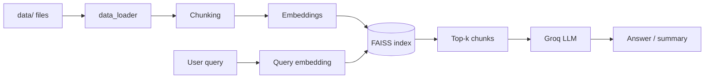

# DocuQuery

A Retrieval-Augmented Generation (RAG) app for asking questions about your own documents. It loads files, splits them into chunks, embeds them with Sentence Transformers, and stores them in a FAISS index. It then retrieves the most relevant chunks for a query and has a Groq-hosted LLM summarize the answer.

## Features

- Loads PDF, TXT, CSV, XLSX, DOCX and JSON files from a `data/` folder
- Splits text with `RecursiveCharacterTextSplitter` (1000 characters, 200 overlap)
- Embeds chunks with `all-MiniLM-L6-v2`
- Stores vectors locally in FAISS (`faiss_store/`)
- Summarizes retrieved context with an LLM through Groq (`langchain-groq`)

## Architecture



## Project Structure

```
app.py                 # Entry point
src/
  data_loader.py       # Loads documents from data/
  embedding.py         # Chunking + embedding pipeline
  vectorstore.py       # FAISS store (build / save / load / query)
  search.py            # RAGSearch: retrieval + LLM summarization
notebook/              # Exploration notebooks
agenticrag/            # Agentic RAG experiments (LangGraph)
requirements.txt
```

## Setup

```bash
git clone <your-repo-url>
cd <repo-folder>
python -m venv venv
venv\Scripts\activate        # Windows
pip install -r requirements.txt
```

Create a `.env` file in the project root:

```
GROQ_API_KEY=your_groq_api_key
```

## Usage

1. Put your documents in a `data/` folder.
2. Run:

```bash
python app.py
```

On the first run, the FAISS index is built from `data/` and saved to `faiss_store/`. Later runs load the saved index.

To change the question, edit the `query` in [app.py](app.py), or use the API directly:

```python
from src.search import RAGSearch

rag = RAGSearch()
print(rag.search_and_summarize("What is attention mechanism?", top_k=3))
```

## Configuration

| Option | Default | Where |
|---|---|---|
| Embedding model | `all-MiniLM-L6-v2` | `FaissVectorStore`, `RAGSearch` |
| LLM | `gemma2-9b-it` | `RAGSearch` |
| Chunk size / overlap | 1000 / 200 | `FaissVectorStore` |
| Top-k | 5 | `search_and_summarize` |

## Tech Stack

Python, LangChain, FAISS, Sentence Transformers, Groq, python-dotenv

## License

See [LICENSE](LICENSE).